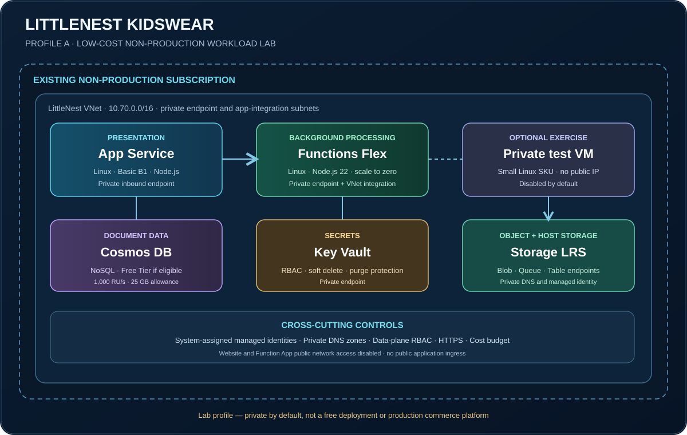

# Azure Workload Landing Zone Code Reference — LittleNest Kidswear

> **A public, hands-on code reference for learning Azure architecture.** The companion [Azure Master Vault](https://github.com/tripathies/azure-master-vault) explains the services and concepts. This project shows how to assemble selected services into a deployable workload, run the application, validate the network and identity paths, and clean up.

## What this project is

This project folder contains **real application source code and Terraform infrastructure code** for a small children's clothing e-commerce learning application named **LittleNest Kidswear**.

It is designed as a step-by-step reference that other learners can clone, inspect, test and adapt.

| Knowledge layer | Where to learn |
|---|---|
| Azure service theory and component catalogue | [Azure Master Vault](https://github.com/tripathies/azure-master-vault) |
| Landing-zone and subscription concepts | [Azure Landing Zones in the Vault](https://github.com/tripathies/azure-master-vault/tree/main/A-cloud-foundation-landing-zones) |
| Reusable network and identity concepts | [Networking](https://github.com/tripathies/azure-master-vault/tree/main/C-networking-private-connectivity) · [Identity](https://github.com/tripathies/azure-master-vault/tree/main/B-identity-access-management) |
| Working application and infrastructure | This project folder |

**Do not confuse a workload lab with a complete enterprise landing-zone deployment.** Profile A assumes that a non-production subscription already exists and is governed by the organisation. It creates the workload resource group, VNet, private endpoints, private DNS, app services, data services and role assignments. It does not create the Entra tenant, management groups, subscriptions, hub network or central security platform.

## Profile A — Low-cost, non-production lab

The default profile is intentionally limited to one dedicated non-production subscription.

| Layer | Azure service | Purpose |
|---|---|---|
| Presentation | Azure App Service (Linux, Basic B1) | Serves the LittleNest web experience; private inbound endpoint |
| Background processing | Azure Functions Flex Consumption | Processes order messages asynchronously; private inbound endpoint and VNet integration |
| Data | Azure Cosmos DB for NoSQL | Small product and demo-order catalogue; Free Tier when eligible |
| Object and host storage | Azure Storage (Standard LRS) | Function package/host storage, queue and optional media |
| Secrets | Azure Key Vault | Stores optional demo secrets; managed-identity access |
| Network | Azure VNet | Isolated app integration and private endpoint subnets |
| DNS | Azure Private DNS | Resolves App Service, Functions, Cosmos DB, Key Vault and Storage private endpoints |
| Identity | System-assigned managed identities | Passwordless service-to-service access |
| Optional test host | Small private Linux VM | Runs connectivity checks from inside the VNet; disabled by default |

### Cost is low, not zero

The App Service Basic plan, private endpoints, Storage operations and any Cosmos DB usage above the eligible Free Tier allowance incur charges. The optional VM also incurs compute and disk cost while allocated. This is not a free-tier end-to-end deployment.

- Cosmos DB Free Tier is selected at account creation, is limited to one eligible account per subscription and includes up to 1,000 RU/s and 25 GB. Verify eligibility before applying.
- Private Endpoints are intentionally included to teach the private-access pattern. They have recurring hourly and data-processing charges.
- Use terraform destroy after the lab and check for soft-deleted Key Vaults, retained data and any resources created outside Terraform.
- Configure an Azure budget before deployment. A budget sends notifications; it is not a hard spending cap.

## Architecture boundary

The code uses private access as the default: public network access is disabled for the App Service, Function App, Cosmos DB, Key Vault and Storage account. That means the deployed web app is **not directly reachable from the public internet**. Run the website locally in demo mode for a public-facing learning preview, or access the deployed private app from a client with a route into the VNet. The optional test VM can be used for private DNS and connectivity checks through Azure Run Command without opening SSH to the internet.

The default lab does not include Front Door Premium, Azure Firewall, NAT Gateway, Bastion, Container Apps, production subscriptions or cross-region recovery. Those are documented as future extensions rather than silently added to a low-cost lab.

## Repository layout

~~~text
azure-landing-zone-reference/
├── app/
│   ├── web/                 # Node.js storefront source code
│   └── functions/           # Node.js Azure Functions order worker
├── infra/                   # Terraform infrastructure
├── docs/
│   ├── architecture.mmd     # Editable Mermaid diagram source
│   └── architecture.svg     # Rendered architecture visual
├── scripts/
│   ├── Test-AzureContext.ps1
│   └── seed-cosmos.mjs
├── README.md
└── .gitignore
~~~

## 1. Prerequisites

- An Azure non-production subscription with permission to create the resources in this lab.
- A deployment identity with resource creation rights and permission to create role assignments (for example, Contributor plus User Access Administrator or Role Based Access Control Administrator at the lab scope).
- For Terraform-managed Storage data-plane objects with shared-key access disabled, the deploying identity needs appropriate Storage Blob and Queue data roles. The AzureRM provider is configured to use Entra ID for Storage data-plane operations.
- Azure CLI.
- Terraform 1.9 or later.
- Node.js 22 LTS and npm.
- Azure Functions Core Tools v4 for publishing the Function App.
- PowerShell 7 for the preflight helper (optional but recommended).

The Flex Consumption plan requires the Microsoft.App resource provider and a supported Azure region. The default region is centralindia; verify current regional support and subscription quota before deploying.

## 2. Local website preview — no Azure resources required

~~~powershell
cd app/web
npm install
$env:LOCAL_DEMO_MODE = "true"
npm start
~~~

Open http://localhost:3000. The storefront uses the bundled sample product catalogue and an in-memory demo checkout when LOCAL_DEMO_MODE=true. No Azure credentials or Azure resources are required for this mode.

## 3. Verify Azure context before Terraform

From the project folder:

~~~powershell
az login
az account list --output table
az account set --subscription "<non-production-subscription-id>"
az account show --query "{tenant:tenantId,subscription:id,name:name,user:user.name}" --output table

./scripts/Test-AzureContext.ps1 -Location centralindia
~~~

Stop if the active tenant or subscription ID is not the intended non-production target. Never use a production subscription for this exercise.

## 4. Configure and review infrastructure

~~~powershell
cd infra
Copy-Item terraform.tfvars.example terraform.tfvars
# Edit terraform.tfvars and set the exact subscription_id.
terraform init
terraform fmt -check
terraform validate
terraform plan -out tfplan
terraform show tfplan
~~~

Review every resource and expected charge. In particular, check the Private Endpoint count, App Service Basic plan, Cosmos DB Free Tier eligibility and the selected region.

Only then apply:

~~~powershell
terraform apply tfplan
~~~

Terraform creates no resources until apply is run. The default plan does not create the optional VM.

## 5. Deploy the application code

After infrastructure is deployed, run application deployment from a workstation with private network connectivity to the VNet (for example, a VPN-connected workstation). Public network access is disabled, including App Service and Functions SCM deployment endpoints. An internet-only laptop or GitHub-hosted runner cannot reach those private deployment endpoints. Publish the website:

~~~powershell
cd ../app/web
Compress-Archive -Path server.js,package.json,public -DestinationPath webapp.zip -Force
$rg = terraform -chdir=../../infra output -raw resource_group_name
$web = terraform -chdir=../../infra output -raw web_app_name
az webapp deploy --resource-group $rg --name $web --src-path webapp.zip --type zip
~~~

Publish the background worker using Azure Functions Core Tools from the same private-connected workstation:

~~~powershell
cd ../functions
npm install
$fn = terraform -chdir=../../infra output -raw function_app_name
func azure functionapp publish $fn
~~~

Flex Consumption deployment uses a package stored in Blob Storage. Confirm the deployment package, Function host status and queue trigger health after publication. Managed-identity role assignments can take several minutes to propagate.

## 6. Seed sample products and test data access

The seed script uses DefaultAzureCredential. Locally, sign in with Azure CLI and run it from a network that can resolve and reach the private Cosmos DB endpoint. The identity used for seeding needs the Cosmos DB data-plane role.

~~~powershell
cd ../../scripts
npm install
$env:COSMOS_ENDPOINT = "<cosmos-endpoint-output>"
$env:COSMOS_DATABASE = "littlenest"
$env:COSMOS_PRODUCTS_CONTAINER = "products"
node ./seed-cosmos.mjs
~~~

When the app is deployed, its system-assigned managed identity reads Cosmos DB and sends order messages to Storage Queue. The Function App's managed identity receives queue messages and updates demo order status. No account keys or connection strings are embedded in the application source.

## 7. Optional private test VM

The optional VM is disabled by default. To enable it, set vm_enabled=true and provide your SSH **public** key in vm_admin_ssh_public_key. The VM has no public IP. Use Azure VM Run Command to run DNS and HTTPS checks from inside the VNet. Do not add an internet-facing SSH rule.

## 8. Validate private connectivity and identity

Use the acceptance checklist in docs/validation.md. At minimum, prove:

- Private DNS resolves each service hostname to its private endpoint address from a client inside the VNet.
- Public network access remains disabled on private-only services.
- App Service and Function App identities have only the required data-plane roles.
- The web app can read the product catalogue and enqueue a demo order.
- The Function worker consumes the order message and updates its status.
- No application setting or source file contains a storage key, Cosmos key or Key Vault secret value.

## 9. Clean up

~~~powershell
cd infra
terraform destroy
~~~

Review the plan before confirming. Check Azure Cost Management after deletion for retained resources, soft-deleted Key Vault, storage data, logs or any manually created resources. Remove local tfplan and terraform.tfstate securely.

## Learning roadmap

1. Read the [Azure Master Vault](https://github.com/tripathies/azure-master-vault) component guide for each service.
2. Review the architecture diagram and editable Mermaid source.
3. Run the storefront locally.
4. Complete the Azure CLI preflight.
5. Read the Terraform modules and inspect the plan.
6. Deploy into a disposable non-production subscription.
7. Validate private DNS, managed identity and order processing.
8. Destroy the lab and record the cost/architecture trade-offs.

## Important limitations

This is an educational reference, not a production commerce platform or a Microsoft-certified landing-zone accelerator. It uses synthetic data, a simulated checkout and a simple sample order workflow. It does not implement real customer identity, payment processing, tax, shipping, fraud protection, inventory reservations, production SLAs, backup/DR or formal compliance controls.

## Related official documentation

- [Azure Landing Zones](https://learn.microsoft.com/azure/cloud-adoption-framework/ready/landing-zone/)
- [Azure App Service private endpoints](https://learn.microsoft.com/azure/app-service/overview-private-endpoint)
- [Azure Functions networking options](https://learn.microsoft.com/azure/azure-functions/functions-networking-options)
- [Azure Functions Flex Consumption](https://learn.microsoft.com/azure/azure-functions/flex-consumption-plan)
- [Cosmos DB Free Tier](https://learn.microsoft.com/azure/cosmos-db/free-tier)
- [Terraform AzureRM provider](https://registry.terraform.io/providers/hashicorp/azurerm/latest/docs)

---

**License:** This project inherits the non-commercial code and documentation terms stated in the parent repository. See the parent LICENSE-CODE.md and LICENSE-DOCS.md before reuse.